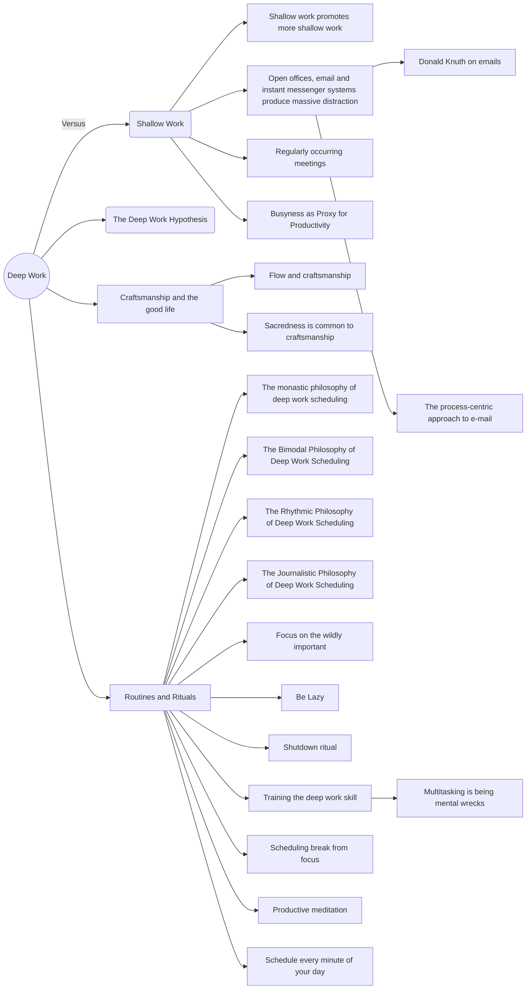

A few tips on making posts below.


# Background: files, identifiers and metadata

1. Blog files need to **start** with a **date** with hyphens eg `2021-09-08`
2. **Metadata**: Each blog entry should contain a title and a date. Optionally, also a review flag.
3. Publishing: The **webapp** uses the DB registry as an **index**, and the local files for the MD **contents**. 
	1. The ID of blog entries is the file name. 
	2. Blog ID is stored in the `md_file` field of Publications. 
	3. Internal DB ID is the auto-increment number as usual.
4. Blogs **permalink** is similar to the Wordpress one, eg "/2018/11/23/exploring-scholarly-publications-via-dbpedia/". 
	1. Permalink depends entirely on file name (blog ID), not the publication date metadata found in MD file.
5. Preview: Posts in '**review**' mode are still visible in local Django for **admins**. 
	1. Eg http://127.0.0.1:8000/words/?query=date&type=review


# Front matter fields

All fields go between the two `---` lines, one per line. Only `title` and `date` are required.

```yaml
---
title: "Livecoding: Techno jam"
date: "2024-07-05"
review: false
description: "One sentence for search results and link previews."
categories:
  - "computermusic"
tags:
  - "livecoding"
  - "extempore"
project: "themusicalcode"
video: "Mk31VUWwDnQ"
---
```

- `review: true` keeps the post as a draft: visible locally to admins, left out of listings, feeds and Sounds.
- `description` is used for the meta description; without it the opening paragraph is used.
- `categories` come from a fixed list (`researchapp/category_vocabulary.py`: computermusic, data-science, digital-humanities, justblogging, knowledge-engineering, research-analytics, techlife). `tags` should be in `researchapp/tag_vocabulary.py`; the reindex lists any that aren't.
- `project` links the post to a project, by the project's URL name (the `<name>` in `/projects/<name>/`). The post then appears under the project's writing. One project per post. The reindex reports names that match no project.
- `video` marks the post as a **piece of music for the Sounds page**, by YouTube id (the part after `watch?v=` or `embed/`). The post is listed under Livecoding, with that video's thumbnail, linking back to the post. Use it only for posts that present a piece of yours, not for posts that merely contain a video. When a post has several videos, it names the one to show. The post still needs the video embedded in its text to play it. (Sounds is built this way from the tiles layout on branch `layout-prototypes` onwards; until that goes live, the old Sounds page still lists its own database entries.)

After adding or changing any of these, run `./tools/blogs-reindex`: each one counts as a change to the post, like a new title or tag.


# Making a new post: 


## 1 Write a new post

Obsidian: 
- Open Obsidian and select the Vault with the blog entries in it. 
- Copy this template, rename it and add contents as needed. 

Alternatively, from the command line:

```bash
$ new_blog_post
```

This Duplicates `2022-09-07-TEMPLATE-POST.md` and lets you edit it. 


## 2 Reindex the site

Once it's done, reindex the blog metadata on the site (Django DB)

```bash
$ ./tools/blogs-reindex
# syncs local MD folder with DB // add, update, delete records as needed 
```

NOTE All items, even with 'review' = True, are added to the DB
NOTE the blogs contents (= text) never enter the DB! Just the blog metadata.


## 3 Testing a new post in review

* log in Django admin
* use the review page http://127.0.0.1:8000/words/?query=date&type=review or the admin link 'view on site' 


## 4 Publish it

```bash
$ ./tools/site-dump-and-publish
```

If Django is running, the wget extraction script will pull the entire site, copy it to /docs and push it to Github. 


# Images 

Images are added to a standard folder 
`/Users/michele.pasin/dev2/research_portal_2019/researcher/src/static/blog_img`

File name should include the date of the post and a short description eg `2026-04-29-latam-funding.png`.

To generate the hyperlink in markdown:

1. Copy image file with cmd+C (so to copy the filename)
2. Type `.image`  and let Textpander do the rest!

Example: 
`[](/media/static/blog_img/img.jpg)`


## Mermaid test

It doesn't work via Python apparently, we may have to install https://facelessuser.github.io/pymdown-extensions/extensions/superfences/




